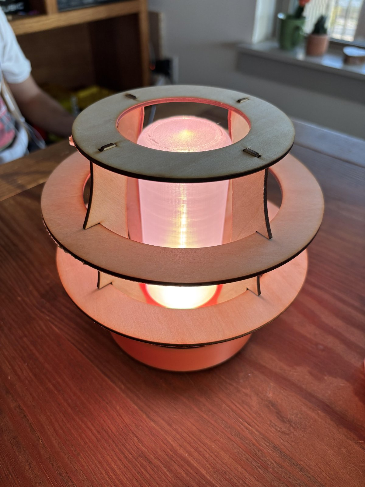
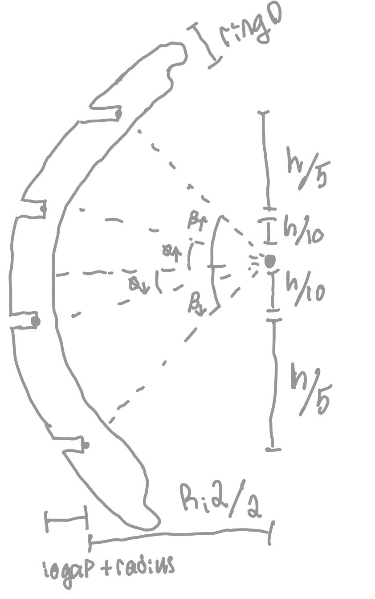
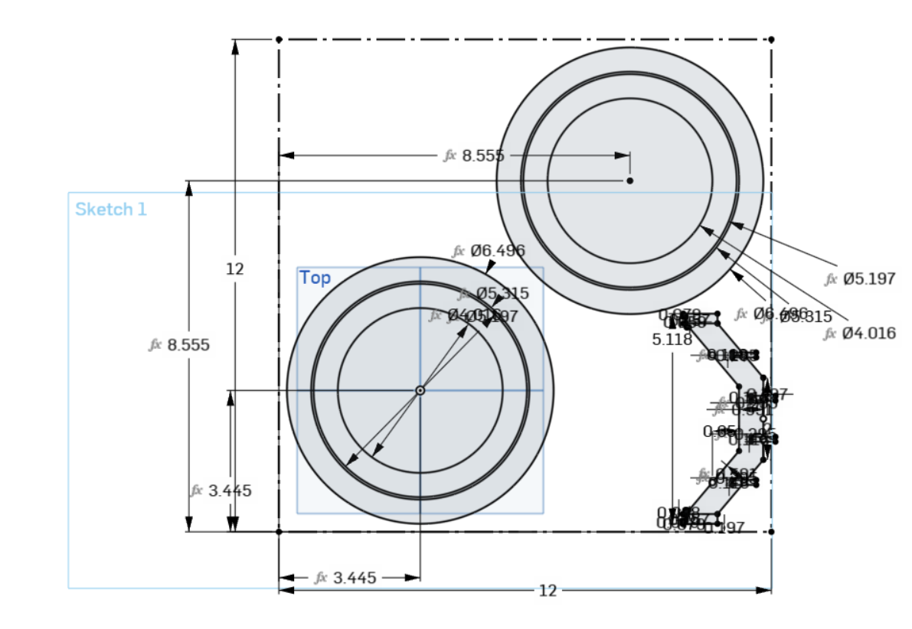
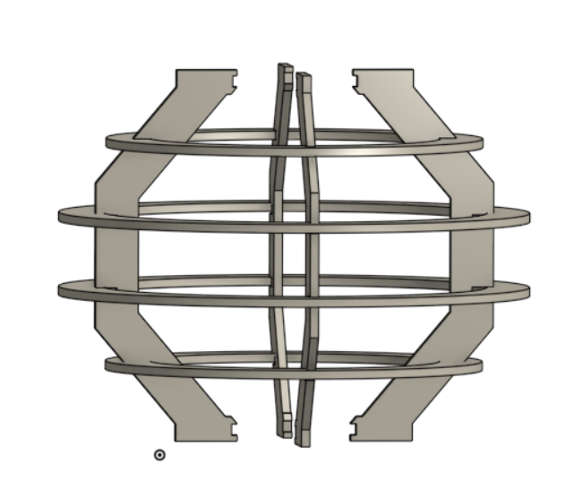
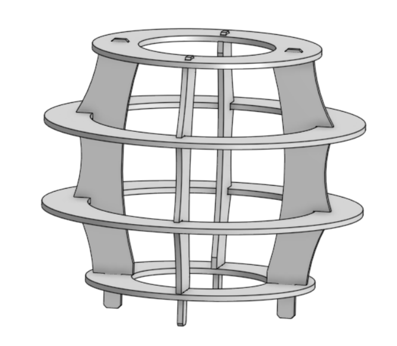
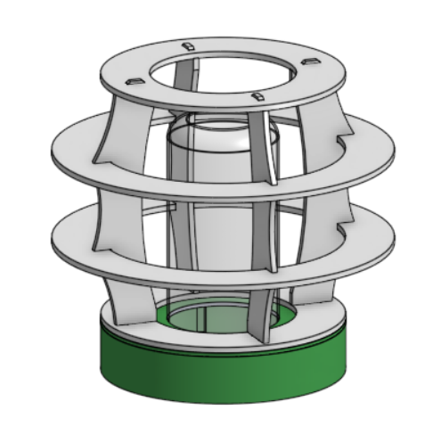
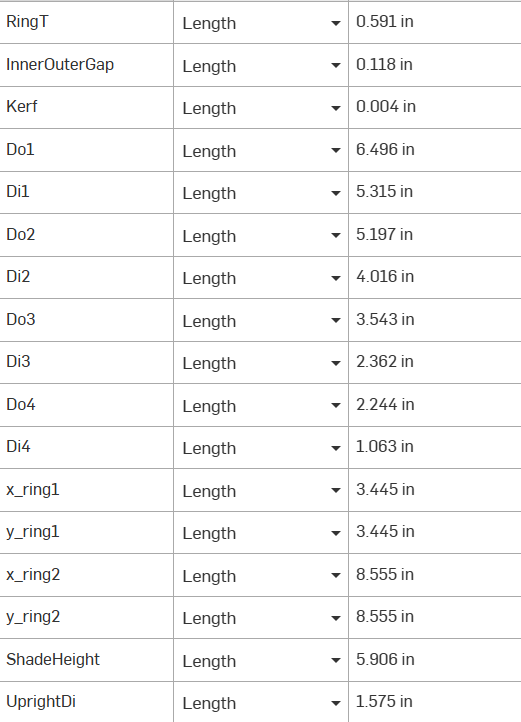
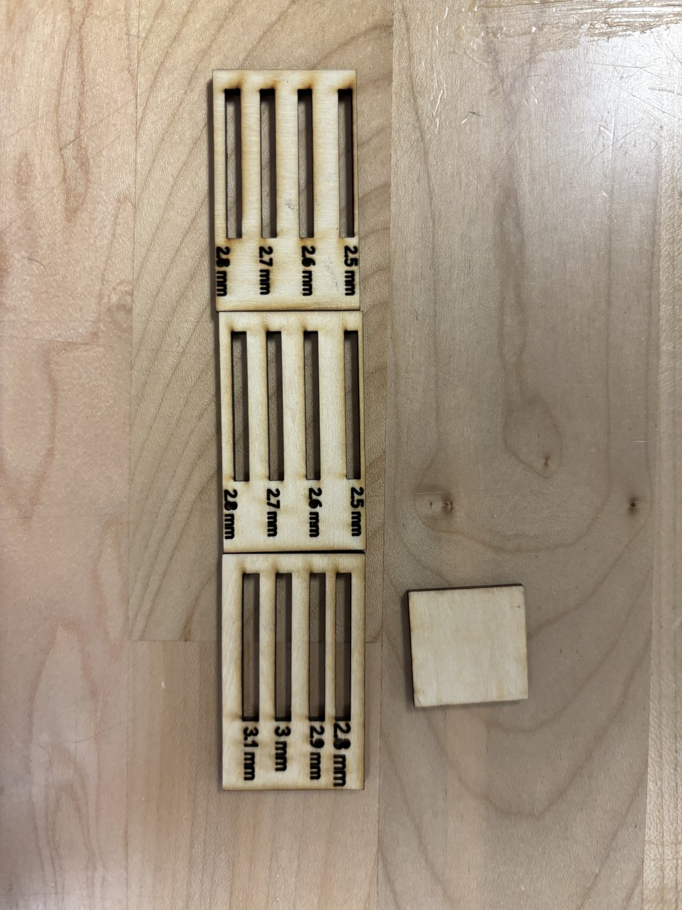
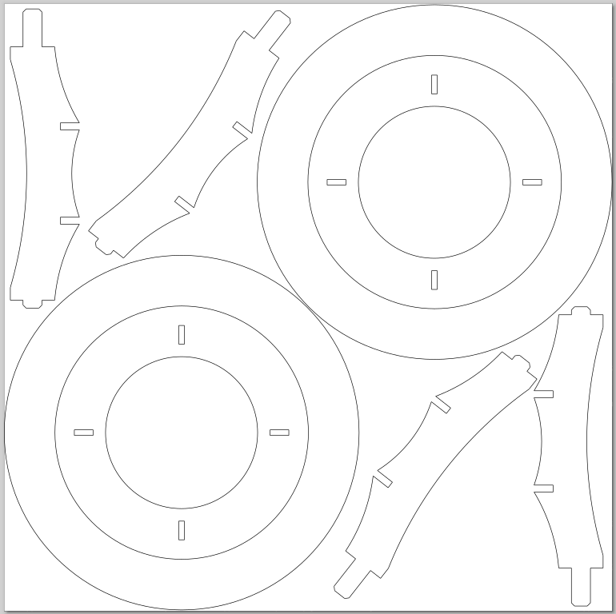
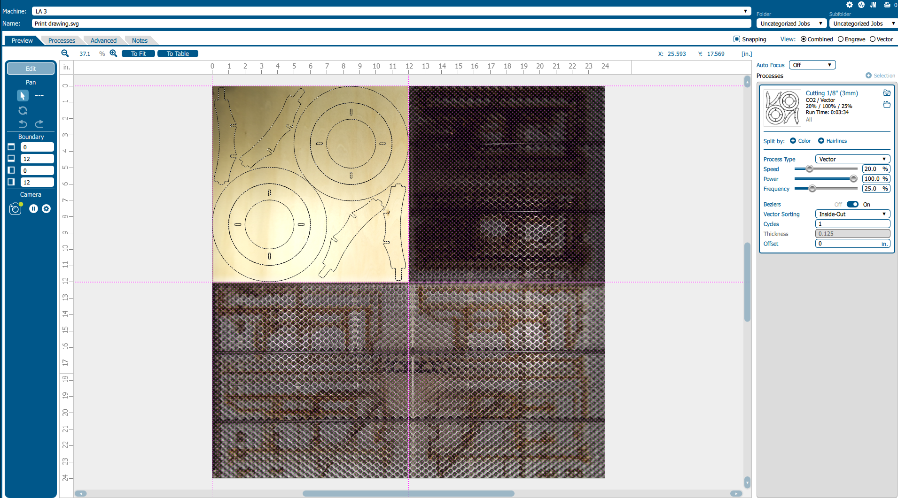

# L09 – Laser Cut Lamp Diffuser

## Objective

Design a lamp diffuser to be laser cut out of a 3 mm sheet of balsa wood. Account for kerf and clearance such that it can support a press fit connection between members. We would like to diffuse light traveling upwards from the base and diffuse subtly outwards. The base that holds the light source will be 3d printed so this writeup will primarily focus on the shade itself. The assignment outlines a requirement of 3 unique laser cut parts with a minimum of 8 total pieces.

Once we have our part designed with easy to edit parameters we need to test for clearance and kerf values derived from material thickness measurements and two test cuts (one for kerf and one for press fit tolerances). Following that we will update our CAD and run the full cut. If all of the previous work is done well, assembly should be quite simple and we will have a complete diffuser ready for use.

## Design

  
  
  

This project was conceptualized in OnShape with the final design work being done in SolidWorks. The conceptual work was mostly figuring out how all of the pieces would be constrained and ensuring all parts could fit on the material stock we were provided. The final design work was working through aesthetics, clearances, and kerf values. Both were designed parametrically. Clearance values were minimal, just accounting for the variance in stock thickness (±.2 mm on a 3 mm sheet). Because the material we are using is fairly compliant, we were able to keep the fits tight. The small rings are attached with a press fit.

While trying to design the test piece, we wanted to make as many dimensions as possible reliant upon a small handful of parameters (the control factors), so a lot of sketches like the one shown above were used to define those. The final version used a very different upright geometry, however it retained a lot of the same math that allowed for parametric design in the test part.

  
  

### Control Factors

- Slot width of 2.5 mm plus clearance
- Max ring diameter of 165 mm to fit two sets on a 12 x 12 sheet
- 2D distance between inner and outer ring: 1.5 mm
- Height of the "shade" = 150 mm (laser cut parts only, excluding the 3d printed base)
- Ring diameters: the inner ring fits into the outer ring to allow for four large circular parts within the 12 x 12 piece of material. The smaller ring is the inner diameter of the large one minus the kerf value.

### Noise Factors

- **Kerf variation:** accounted for with clearance and the softness of the material, as it's such a small value.
- **Material thickness:** varied ±.2 mm across the sheet, which is what the clearance is sized for.
- **Focus:** error added through this is accounted for through kerf and clearance. It is quite hard to get a defined value for the error here, as it changes based upon variation in the wood thickness as well as the flatness of the workspace.

### Parameter Table

  

| Variable name | Value | Units | Source (measured or chosen) | What it controls |
|---|---|---|---|---|
| Material thickness | 2.88 | mm | Measured (Step 1) | Slot width |
| Kerf | 0.004 in (≈ 0.1) | mm | Measured (Step 2) | Offset on every cut edge |
| Clearance | −0.23 (0.23 interference) | mm | Chosen (Step 4) | Tightness of the press fit |
| Slot width | 2.5 drawn, 2.65 after kerf | mm | Chosen from fit coupon | Slots the uprights press into |
| RingT | 0.591 in (15) | mm | Chosen | Radial width of each ring |
| InnerOuterGap | 0.118 in (3) | mm | Chosen | Gap between nested rings (1.5 mm per side) |
| Do1 | 6.496 in (165) | mm | Chosen | Largest ring, sized to fit two sets on the sheet |
| ShadeHeight | 5.906 in (150) | mm | Chosen | Height of the laser cut shade |
| UprightDi | 1.575 in (40) | mm | Chosen | Inner diameter the uprights wrap around |
| x_ring / y_ring | 3.445, 8.555 | in | Chosen | Ring centers on the 12 x 12 sheet |

<video
  src="variable_change.mp4"
  controls muted loop playsinline
  preload="metadata"
  style="display:block; max-width:100%; max-height:600px; margin:1em auto; border-radius:4px;">
  Your browser doesn't support HTML5 video.
</video>

Changing RingT in the variable table regenerates the test sheet: the inner diameter of every ring updates, and the nested rings resize with it so they still fit inside each other.

### Engineered Allowances

The sheet is sold as 3 mm but measured 2.88 mm on average, so the slot is driven by the thickness variable instead of the nominal value. Kerf was measured with a square coupon (see Manufacturing) and entered into the model as 0.004 in. Clearance only had to cover the ±.2 mm variation in the stock, and since balsa is so compliant the fits could stay tight without cracking anything.

The fit coupon pointed us to a 2.5 mm drawn slot. The laser widens that by the average kerf of 0.15 mm, so the slot actually cuts at 2.5 + 0.15 = 2.65 mm. Subtracting that from the 2.88 mm sheet gives 2.88 − 2.65 = 0.23 mm, which means the board is 0.23 mm thicker than the slot it goes into. That is a small interference (a clearance of −0.23 mm), and it's what makes the joint a press fit.

## Manufacturing, including Process Research

### Laser Cutting Justification and Explanation

Laser cutters work by focusing high energy lasers onto a part to essentially melt or burn away the material. This form of manufacturing requires blank material and large energy costs but is fast and relatively repeatable. For most materials, the laser provides so much concentrated power that the material as a whole stays cool while the spot the laser is focused on evaporates. Because focusing implies the ray comes together at a point and then diverges again, the edge of a cut is ever so slightly tapered. This is far more apparent on a thicker blank, but the height of the laser above the workpiece can also affect the angle of this taper.

The two most prevalent types of lasers on the market today are CO2 and fiber lasers. Fiber lasers are typically more expensive than CO2 lasers as they are able to do all of the same things but are more efficient, capable, and reliable. A big part of this reliability comes from using a fiber cable rather than mirrors, as well as the laser source having a much longer lifecycle. The wavelength differences also account for some of the differences in performance. Fiber lasers have a shorter wavelength than CO2 lasers. This is not an issue with organic materials and plastics, but CO2 lasers struggle to cut metals. Metal is however able to absorb short wavelengths, so for a process that is suitable for metallic part manufacturing, one would seek out a fiber unit. Lastly, fiber laser machines are able to focus on a much smaller point, which in practice means far higher energy density with the same total input. More energy per unit of surface area means cuts are much faster and have tighter tolerances.

Comparing laser cutting machines to FDM printers and CNC routers, it becomes apparent that they excel in some use cases and fall on their faces in others. Firstly, laser cutters are strictly for 2d manufacturing, with small exceptions for etching. They are however the only option out of the three that can make nearly perfectly perpendicular inside corners. Industrial laser machines are often a little bit more expensive than a 3-axis CNC router that could do the same job, but their use case is a little bit more defined. A laser cutter has a much lower tooling cost once purchased, however. Lasers will be the fastest way to make a 2d part in almost all cases, especially as parts get bigger.

### Test Coupons

  

Our first fit coupon had slots from 2.8 to 3.1 mm, and every one of them was too loose. Since our kerf measurement differed between X and Y, we then cut two coupons with slots from 2.5 to 2.8 mm, one laid horizontally on the bed and one laid vertically. The 2.5 mm slot felt quite good in both and we were happy with it, so that became our slot width. The square kerf coupon is on the right.

**Material thickness**

| Thickness Measurement # | 1 | 2 | 3 | Mean |
|---|---|---|---|---|
| Value (mm) | 2.88 | 2.80 | 2.96 | 2.88 |

**Kerf** (Kerf = D − measured width)

| Measurement # | 1 | 2 | 3 | Mean |
|---|---|---|---|---|
| X dimension | .11 mm | .10 mm | .12 mm | .11 mm |
| Y dimension | .17 mm | .21 mm | .19 mm | .19 mm |

The kerf was noticeably larger in Y than in X. Averaging all six measurements gives a kerf of 0.15 mm. Both directions are small enough that the softness of the balsa absorbs the difference.

<!-- TODO: record the kerf square size D. -->

### Laser Process Record

| Setting | Value |
|---|---|
| Laser cutter (name or number) | LA 3 |
| Material type | Balsa Wood |
| Nominal thickness | 3 mm |
| Measured thickness (mean) | 2.88 mm |
| Speed | 20% |
| Power | 100% |
| Frequency or PPI (if applicable) | 25% |
| Number of passes | 1 |
| Focus method and how you confirmed it | Standard focus, confirmed with the lab tech |
| Air assist on? Exhaust on? | Yes and yes |
| How you set origin and alignment | Used the upper left corner for both sketch and material alignment |

### Layout and Cutting

  
  

The largest ring was capped at 165 mm so two full sets fit on the 12" x 12" sheet, and each smaller ring is cut out of the inside of the one before it so four large circular parts come out of one piece of material. The uprights fill in the leftover corners. Origin was set at the upper left corner of both the drawing and the sheet.

<video
  src="cut_video.mp4"
  controls muted loop playsinline
  preload="metadata"
  style="display:block; max-width:100%; max-height:600px; margin:1em auto; border-radius:4px;">
  Your browser doesn't support HTML5 video.
</video>

### Edge Quality

The material was thin enough that we couldn't see the taper from the laser focusing. The edges had some soot on them, but it was super minimal. Air assist and exhaust were both on for the cut.

## Lessons Learned

### Process Log

| Date and time | Time spent | Step | What happened | Decision or change made |
|---|---|---|---|---|
| Fri 10/23 | 2 hr | Design | Made the test CAD in Onshape, set up the global variables and test sheet | Drove the ring and slot dimensions off a handful of variables |
| Sun 10/25 | 1.5 hr | Design | Worked out the math for the uprights | Kept the parametric math for the final upright geometry |
| Mon 10/26 | 3.5 hr | Manufacturing, Lessons Learned | Measured the sheet and kerf, cut the fit coupons, ran the final cut and did the writeup | 2.8–3.1 mm slots were too loose, so we tested 2.5 mm in both directions and went with 2.5 mm |

Total time: 7 hours. The cut settings are in the [Laser Process Record](#laser-process-record) above.

### Resources Used

- One 12" x 12" sheet of 3 mm balsa wood
- PLA filament for the 3d printed base
- A ceiling projector lamp for the light source

### Mistakes and Troubleshooting

A mistake we made was not having tension on the cylindrical members to hold it together. Press fits alone were sufficient but not ideal, as they left us with a bit more slop than we would have liked.

### Reflection

**Where did your measured values differ from what you assumed?** The sheet is labeled 3 mm but measured 2.88 mm on average, and the kerf was different in X (.11 mm) and Y (.19 mm). If we had designed off the nominal 3 mm, every slot would have been oversized and the press fits would have been even looser than they ended up.

**Taguchi's quality loss:** The press fits are the joint that works but isn't on target. If this joint were made by the thousands, it would just lead to a slightly subpar product. It would still work, but it would not be something we could be proud of.

**A real product:** A real product that uses a similar manufacturing technique is the mobile fire pit/grill. If there were a kerf or thickness error, it could lead to the grill falling apart with a fire inside it, which, needless to say, is super dangerous.

**One more cut:** If I had one more cut, I would make some designs in the rings so the light has a more interesting diffusion pattern.
