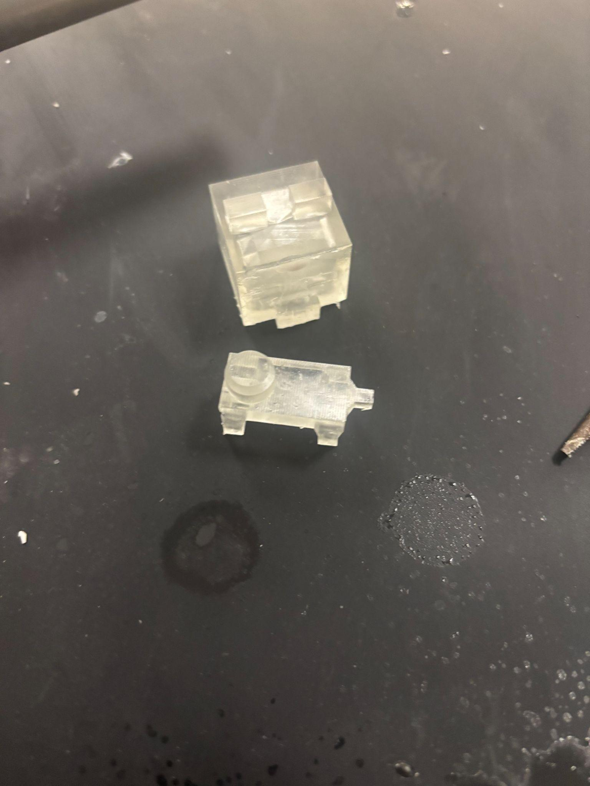
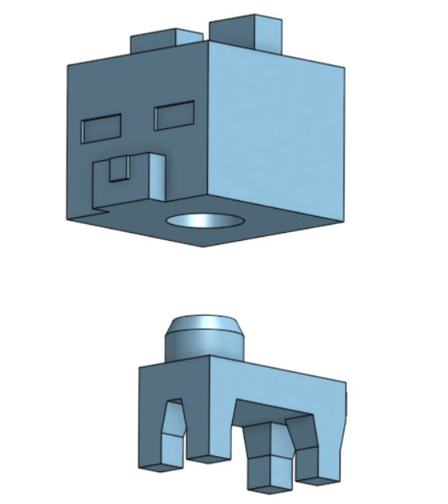
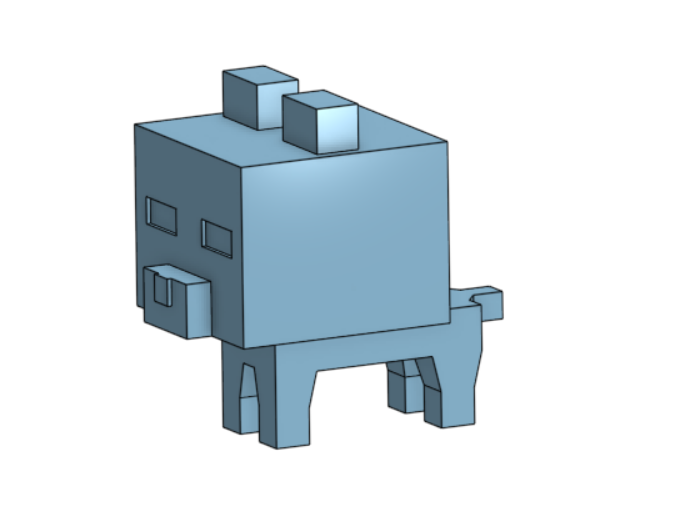
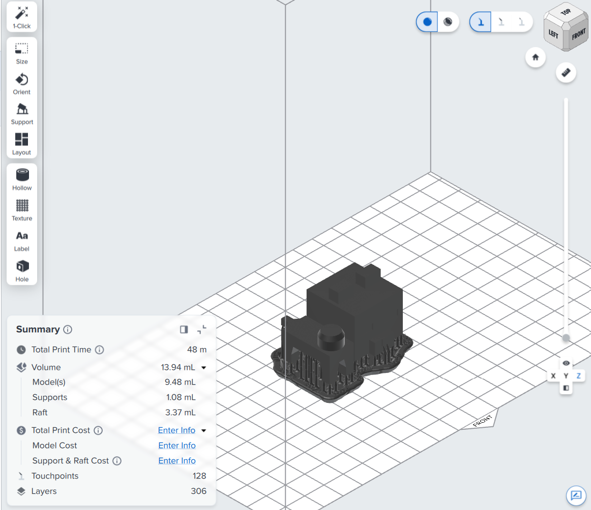
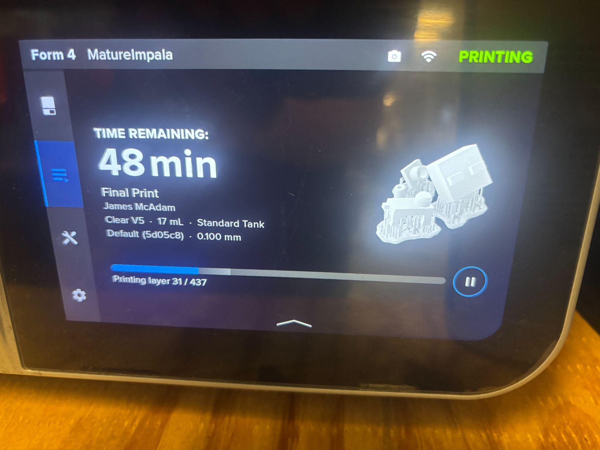
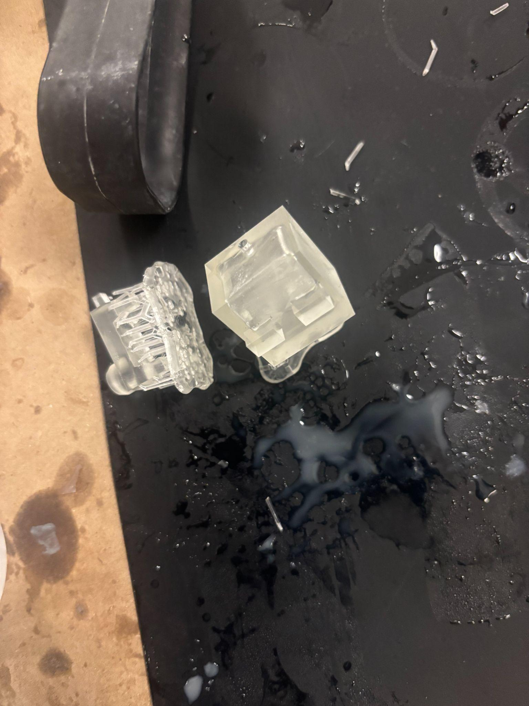

# L10 – RC 2 Sliding Fit Design and Verification

## Objective

Design and print a pair of parts on an SLA printer, one with a hole feature and one with a matching shaft, that demonstrate an RC 2 sliding fit as defined in the Machinery's Handbook:

> "RC 2 Sliding fits are intended for accurate location, but with greater maximum clearance than class RC 1. Parts made to this fit move and turn easily but are not intended to run freely, and in the larger sizes may seize with small temperature changes."

The two parts together could not exceed 20 mL of resin including supports, and the fit had to be part of something with a creative or useful purpose rather than a plain hole and shaft. My design is a small pig figure: the body has a 10 mm pin on top and the head has the matching hole, so the head sits located on the body but can still swivel. Both parts together came in just shy of 14 mL.

## Research and Planning

For a pin and hole with a nominal diameter of 10 mm, the RC 2 tolerances should be within 0.000 to +0.011 mm for the hole and −0.006 to −0.014 mm for the shaft. That works out to a clearance of somewhere between 0.006 and 0.025 mm, which is far tighter than an SLA printer can reliably hold.

<!-- TODO: add hand sketch of both parts showing the RC 2 controlled dimensions. -->

### Where RC 2 Fits Are Used

RC 2 fits are useful for parts that need to swivel but still be located securely. The fit is not so tight that it needs special preparation to mate the two parts, like heating one and cooling the other, but it is also not loose enough to have play that would keep the part from being considered "located" or "fixed" along the desired axis. Common examples are locating pins on jigs and fixtures, gears and pulleys that get shifted by hand along a shaft, and clevis pin joints that need to turn without wobbling.

### Resin Shrinkage

Most SLA prints shrink between 0.5% and 1.5%, however Formlabs printers and PreForm already account for this shrinkage. It is still important to follow their wash and cure steps, as the accuracy of their compensation depends on it. On a 10 mm pin, 1% shrinkage is 0.1 mm, which on its own is several times larger than the entire RC 2 clearance band.

## CAD Design

  
  

The head (Part A) holds the hole feature on its underside and the body (Part B) has the pin on its back. The pin has a small chamfer on the top edge to help it lead into the hole.

<!-- TODO: add a screenshot of the sketch with the pin and hole dimensions shown. -->

**What nominal size did you select?** 10 mm.

**What tolerances did you apply?** After testing with a lot of my classmates, we found that 0.3 mm was roughly the point at which a comfortable fit worked. This is not technically an RC 2 fit by the specs given in the book, but it is what achieved the same function given our manufacturing method.

**How did you determine if the design would achieve the RC 2 fit?** I needed the pin and hole to be as large as they could be given the design intent and the 20 mL material limit. There was a fine margin to hit with the accuracy of this machine, but I felt confident that with the right tolerancing and testing I could get very close to a proper RC 2 class fit.

## Preprocessing

  
  

| Setting | Value |
|---|---|
| Machine | Form 4 (MatureImpala) |
| Resin | Clear V5 |
| Layer height | 0.1 mm |
| Print time | 48 min |
| Layers | 306 |
| Total volume | 13.94 mL (9.48 model, 1.08 supports, 3.37 raft) |
| Supports | Default settings |
| Hollowing | Head hollowed, 2 mm wall, with a vent hole |

**Build orientation:** Both the pin and the hole needed to be printed vertically to make sure they came out perfectly circular, since that is the most important feature on the part. With that in mind I just chose the flattest surface to sit against the build plate.

**Layout:** Jack Brannon and I printed together on the same build plate.

**Supports and wall thickness:** I used the default support settings. Even though I did some research, it seemed like the values that could predictably be changed were already set up in the best possible way for this model. I hollowed out the head to save material and left a wall thickness of 2 mm, then added a vent hole to get the excess resin out.

**Layer height:** 0.1 mm was big enough to get a quick print, and the features didn't need high accuracy along the z direction since the circular profile of the pin and hole is formed in each layer.

## Post-Processing

  
  

<!-- TODO: add photos of the wash and cure stages. -->

The finish is quite incredible for a 3d print. You can really see the difference with the clear resin, as clear FDM prints come out very hazy due to the layer lines. Because the resin is clear, you can also see the hollowed cavity inside the head and the vent hole that drained it.

<!-- TODO: record any dimensional deviations after curing or sanding. -->

## Fit Test

| Feature | Design (mm) | Measured (mm) | RC 2 range (mm) |
|---|---|---|---|
| Hole diameter | | | 10.000 to 10.011 |
| Pin diameter | | | 9.986 to 9.994 |
| Clearance | | | 0.006 to 0.025 |

<!-- TODO: caliper measurements, comparison to RC 2 range, and whether the head slides on and locates. -->

## Lessons Learned

**What challenges arose in achieving the RC 2 fit?** The fit class combined with the volume limit made it quite challenging to find a good middle ground, especially since I wanted the design to be mostly aesthetic with the functional RC 2 fit being only a small part of it.

**Did surface roughness, printer calibration, or curing affect the fit?** Surface roughness was negligible because it was accounted for in the tolerancing. Curing shrunk the parts, but they still had roughly the same fit.

**How could you improve accuracy next time?** Next time I would print a test part first. I thought I would be able to, but I was told not to in order to save resin.

**Time and resources:** 6 hours were spent on this assignment, much of that in the lab. The print used 13.94 mL of Clear V5 resin. I didn't use AI for this assignment beyond asking some questions about SLA printer capabilities.
