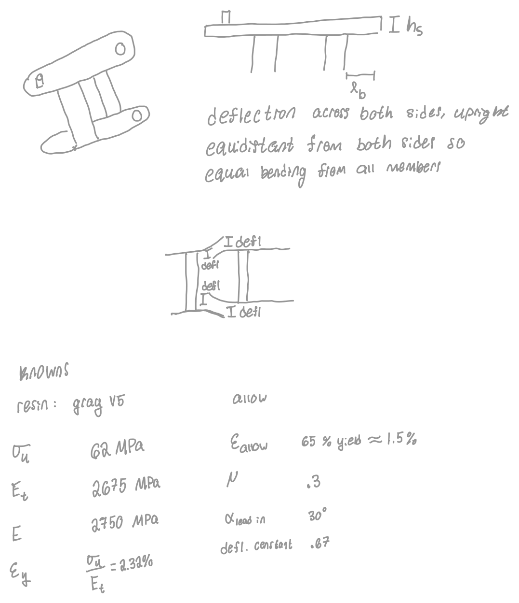
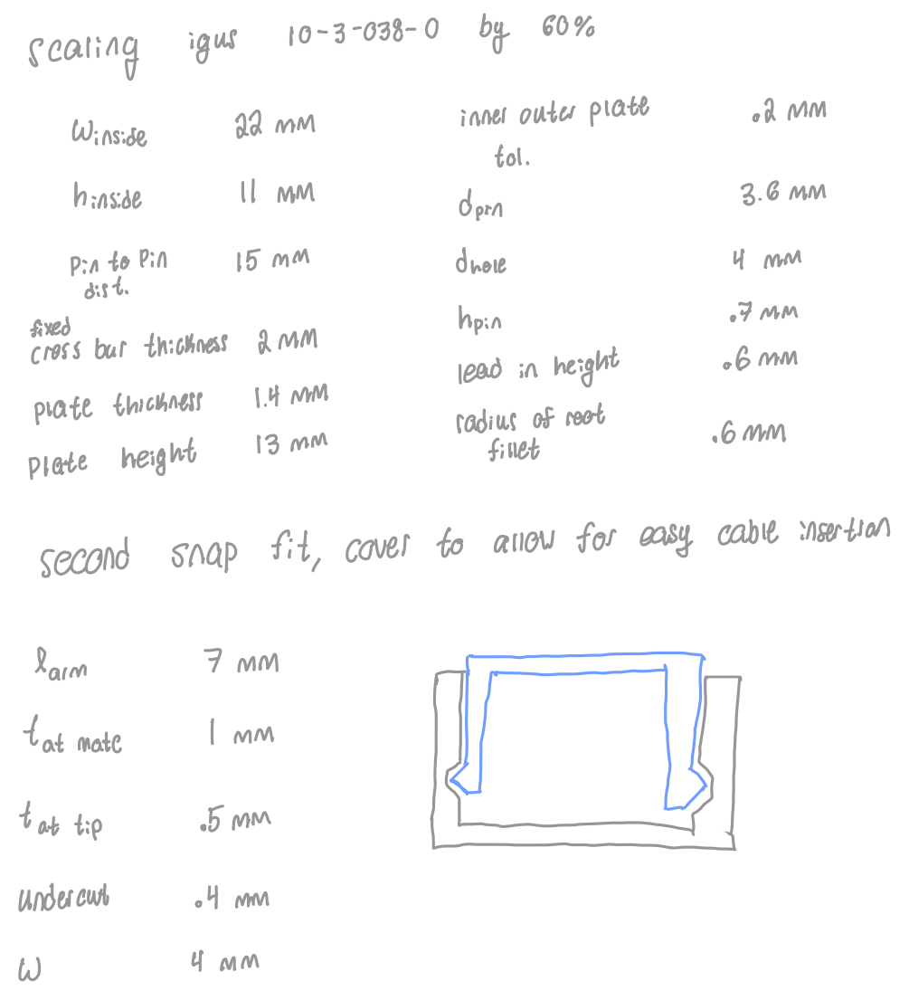
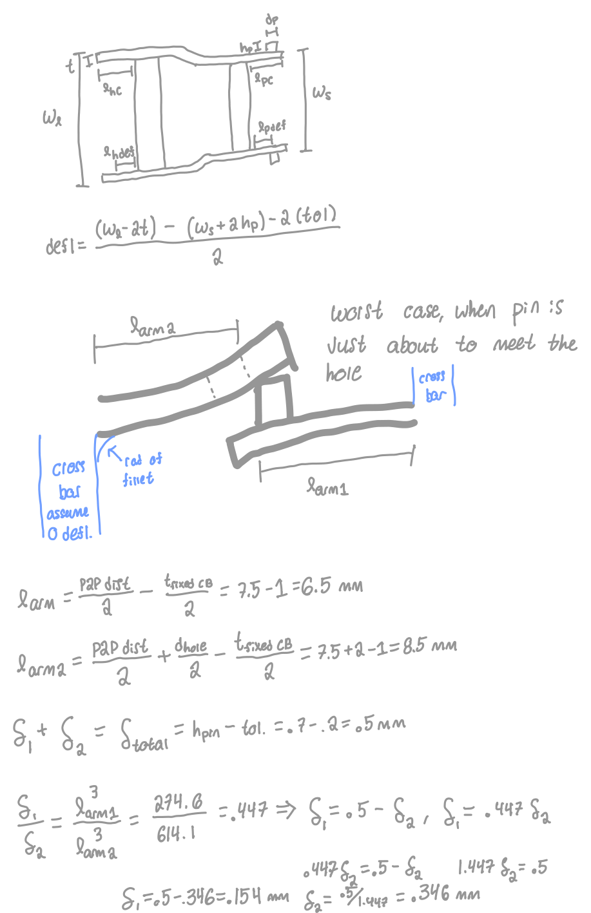
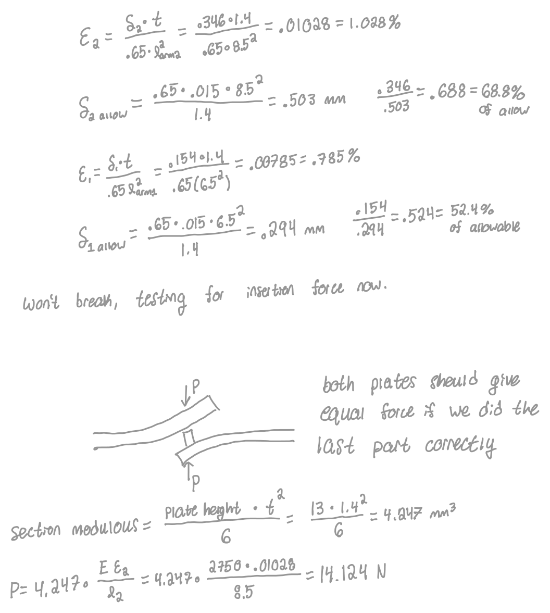
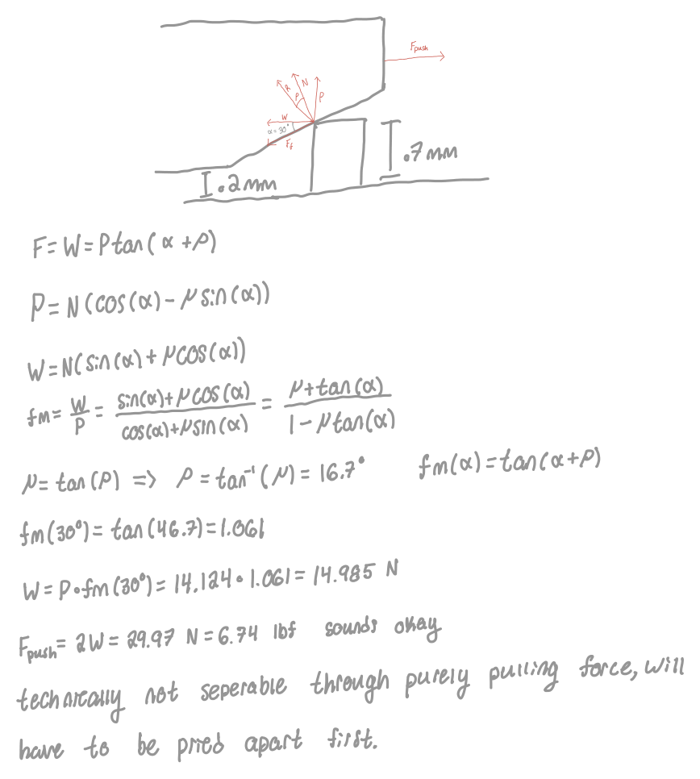
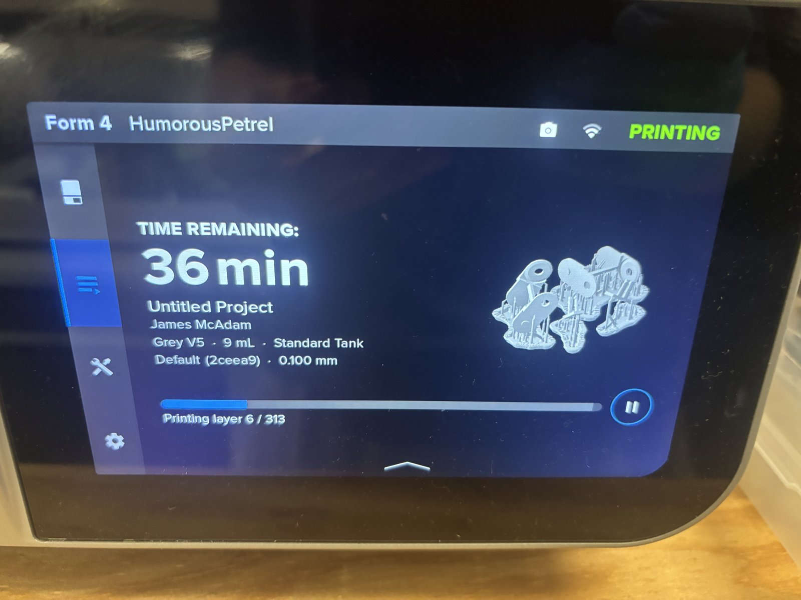

# L11 – Snap Fit Design for SLA Printing

<!-- TODO: hero photo of the assembled cable carrier. -->

## Objective

Design and print a small artifact on the Form 4 made of two or more parts that snap together. The snap fit has to be part of something creative or useful rather than a plain test block. My design is a cable carrier (drag chain) based on the igus 10-3-038-0, scaled to 60%, with snap-on covers so cables can be dropped in from the top.

## Snap-Fit Research

**Type:** a hybrid of two cantilever snap fits.

1. **Link-to-link pin joint:** the overlapping side plates act as cantilevers that spread apart over the pin and drop into the hole. This one is non-separable.
2. **Cover hooks:** the cover bar is held on by two tapered cantilever hooks. This one is separable.

  
  

### Material

| Property (Grey V5) | Value |
|---|---|
| Ultimate strength, σu | 62 MPa |
| Tangent modulus, Et | 2,675 MPa |
| Flexural modulus, E | 2,750 MPa |
| Yield strain, εy ≈ σu/Et | 2.32% |
| Allowable strain (65% of yield) | ≈ 1.5% |
| Friction coefficient, μ | 0.3 |
| Lead-in angle, α | 30° |

SLA resin is stiff and has a low elastic strain limit compared with something like nylon, so I kept the deflections small (0.5 mm total) and the arms as long as the geometry allowed to stay well under the allowable strain.

### Deflection

  

The worst case is when the pin is just about to drop into the hole. The crossbar is assumed not to deflect, so each plate is a cantilever measured from the crossbar:

- Pin plate: l1 = 7.5 − 1 = 6.5 mm
- Hole plate: l2 = 7.5 + 2 − 1 = 8.5 mm

Total deflection is δ = hpin − tol = 0.7 − 0.2 = 0.5 mm. Both plates carry the same force, so the deflection splits by stiffness (δ1/δ2 = l1³/l2³ = 0.447), giving δ1 = 0.154 mm and δ2 = 0.346 mm.

### Strain and Insertion Force

  
  

| Quantity | Hole plate | Pin plate |
|---|---|---|
| Strain, ε = δt / (0.65 l²) | 1.028% | 0.785% |
| Percent of allowable | 68.8% | 52.4% |
| Deflection force, P = Z·E·ε / l | 14.12 N | 14.12 N |

With a section modulus of Z = bt²/6 = 13 · 1.4² / 6 = 4.247 mm³, both plates give the same 14.12 N, which confirms the deflection split. For the mating force, the friction angle is ρ = tan⁻¹(0.3) = 16.7°, so W/P = tan(α + ρ) = 1.061 and W = 14.99 N per side. The total push force is **29.97 N (6.74 lbf)**.

Retention comes from the cylindrical pin sitting in the hole. That face is at 90°, which is above the 73.3° self-locking angle, so the joint can't be pulled apart and has to be pried. A 0.6 mm root fillet (R/h = 0.43) reduces stress concentration where the plate meets the crossbar, and the cover hooks taper from 1.0 mm to 0.5 mm to lower root strain.

<!-- TODO: cite the guide's cantilever deflection/force equations, the R/h stress-concentration figure, and the friction table. -->

Download: <a href="L11 (1).pdf">Full handwritten calculations (PDF)</a>

## Design

| Feature | Dimension (mm) |
|---|---|
| Inside width | 22 |
| Pitch (pin to pin) | 15 |
| Crossbar thickness | 2 |
| Plate thickness × height | 1.4 × 13 (12 in CAD) |
| Inner to outer plate gap | 0.2 |
| Pin | Ø3.6 × 0.7 tall |
| Hole | Ø4.0 |
| Lead-in chamfer | 0.6 deep at 30° |
| Root fillet | 0.6 |
| Cover hook | 7 long, 1.0 → 0.5 taper, 0.4 undercut, 4 wide |

<!-- TODO: CAD screenshots (sketch, model, assembly) and exploded/assembled views. -->

The model was built in Onshape and driven by a Variable Studio, so every dimension is parametric.

Download: <a href="L11.stl">L11.stl</a>

**Iterations:**

- The lead-in was moved from the pin to the plate edge. A chamfered round pin would release just as easily as it engages.
- The plate height was dropped to 12 mm so the rounded plate ends (r = 6) clear the next link while it rotates. This lowers P to about 13.0 N and the push force to about 27.7 N.
- The crossbar was raised so the cover hooks catch underneath it at 7 mm.

## Preprocessing

  
  

| Setting | Value |
|---|---|
| Machine | Form 4 (HumorousPetrel) |
| Resin | Grey V5 |
| Layer height | 0.1 mm |
| Print time | 44 min |
| Layers | 313 |
| Parts | 2 links, 2 covers |
| Total volume | 8.50 mL (2.31 model, 1.32 supports, 4.86 raft) |
| Supports | Default settings |
| Snap clearance | 0.2 mm (plate gap and radial pin to hole) |

**Build orientation:** The links were stood on end so the side plates are vertical and the bending stays in the layer planes. Supports were kept off the pins, holes, chamfers, and hook faces.

<!-- TODO: plate layout with other students, isotropic vs anisotropic, wall thickness. -->

## Post-Processing

<!-- TODO: wash, cure, and support removal photos and times, and observations on fit after curing. -->

The design values assume the enhanced cure (60 °C, 15 min).

## Validation

<!-- TODO: in-class test results and photos/video of the assembled carrier. -->

Predicted: the links snap together at about 28–30 N, and the cover goes on easily and pulls off by hand.

## Lessons Learned

<!-- TODO: finish after testing. -->

The resin's low elastic strain limit pushed the design toward small undercuts and long arms. Clearances also have to stay absolute (0.2 mm) rather than scaling with the part.
