# Final Project – Rotary Medical Tube Cutter

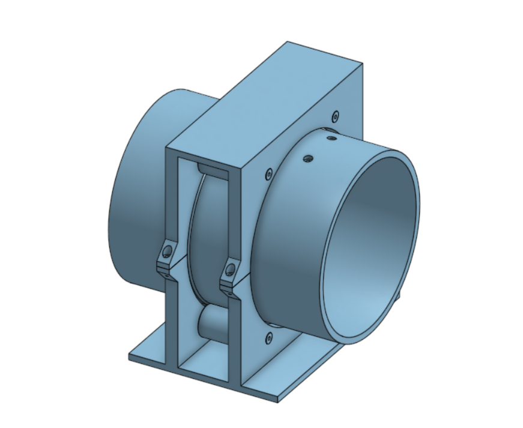

## Objective

Over two weeks, use the Spiral Design Process to plan, prototype, test, and refine a working prototype that solves a real problem. The final prototype has to include parts from at least two of the three manufacturing technologies used in class: FDM, SLA (Form 4, no larger than about one quarter of the build plate), and the laser cutter.

Week 1 is problem selection and the first prototype: pick a real problem that I, a friend, or a family member actually deal with, develop a concept, and test the critical features. My project is a rotary cutter for medical tubing used in quality control. It replaces an existing pneumatic chopping cutter that crushes thin tubes and leaves its blade exposed.

## Research

### Spiral Design Process

  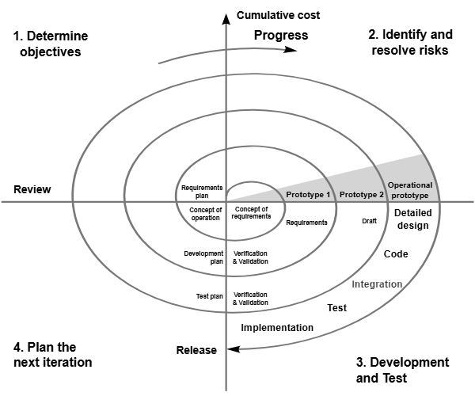

Source: <a href="https://en.wikipedia.org/wiki/Spiral_model">Spiral model (Wikipedia)</a>

The spiral process is the natural order of designing something. You revisit a lot of the same general questions after every iteration in order to refine the design. The four segments of the spiral are:

1. **Determine objectives:** what this loop has to accomplish.
2. **Identify and resolve risks:** find what is most likely to fail and address it first.
3. **Develop and test:** build the prototype for this loop and test it.
4. **Plan the next iteration:** factor what was learned into the next version.

The prototype for each loop is made after step 2, and the last two steps fold what I learned into the next version. For this project, the first loop goes after the riskiest unknowns (the rotation and the cut depth mechanism) before any time is spent on electronics or final parts.

### FDM Anisotropy

FDM parts are printed in layers that adhere to each other imperfectly, so forces in different directions are tolerated differently. This is what makes FDM parts anisotropic, and it is why print orientation matters so much. Stresses are handled better along the layers than across them, and shear across the layers leads to very quick failure. This is especially important for pins. It is natural to print tall cylinders upright, but without the right safety factor that is the weakest way to make a part with forces acting across it from two or more mating parts. For the cutter, the axle pins and anything carrying the cutting load need to be oriented so the load runs along the layers, or be moved to a different process.

### SLA Shrinkage

To reach full strength, SLA prints have to be cured. Curing heats the part so the layers bond better, a bit like sintering a metal part. This improves strength but also makes the part denser, so it shrinks. Shrinkage of 0.5% to 2% is typical for most materials. Modern slicers from the leading manufacturers, including PreForm, already compensate for this by default, but the compensation only holds if the wash and cure steps are followed. Any precision SLA part in the cutter, like the blade holder, will need its critical clearances checked after curing.

### Laser Cut Kerf

  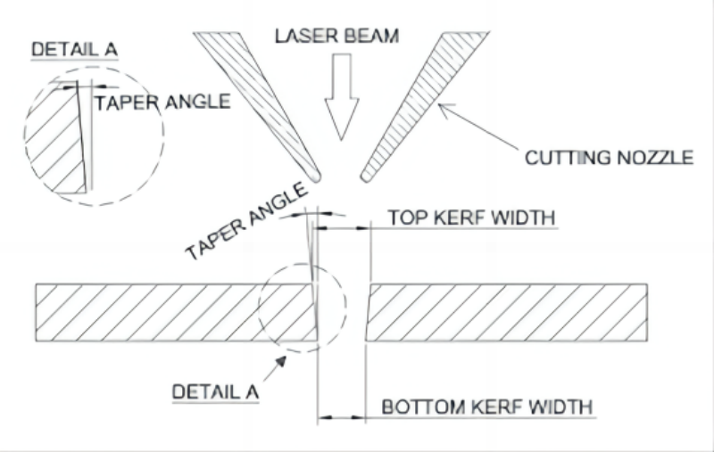

Source: <a href="https://www.durmapress.com/wp-content/uploads/2024/05/Laser-Cutting-Kerf2-1.png">Durmapress</a>

Most laser cutters have only one point of true focus. Away from that depth the beam has a width, which matters most when cutting thicker material because the difference in kerf between the center and the top or bottom surface is much larger. Kerf has to be measured for the specific stock before a reliable cut can be made. Typical kerf is only 0.1 to 0.5 mm, but that is enough to change how tight-tolerance features fit together, so it has to be accounted for on every part of the cutter that has a tight fit.

## Problem Definition

**Desk-mounted cup holder:** A universal cup holder that clamps to a desk. It keeps the desk clear while keeping a drink nearby during long work sessions. It would need to hold up to 5 lb and fit cups of different diameters.

**Surgical tubing cutter for quality control:** Cuts along two directions, uses a razor blade for the actual cut, fits two different types of tubing, and keeps the blade covered when not in use. It has to handle durometers from 50A to 72D and outer diameters from 0.21 to 0.40 in.

**End effector for a personal cobot project:** Two scissor lifts revolved around a remote center of motion for movement along an arc, a limited-slip differential so the arm can be powered with the least resistance, and a second axis of rotation for full mobility around half of a sphere.

**Self-watering planter:** Monitors soil moisture for different plants and drips water on a routine interval, adjusted by the sensor reading. Tracking air temperature and sun exposure would let it adjust for cloudy or cold days, when less water evaporates and more of the supplied water reaches the plant.

## Problem Selection

**Selected problem:** a rotary medical tube cutter.

This problem is the most mechanically demanding of the four, and it has the strongest case for solving something meaningful.

### The Current Cutter

  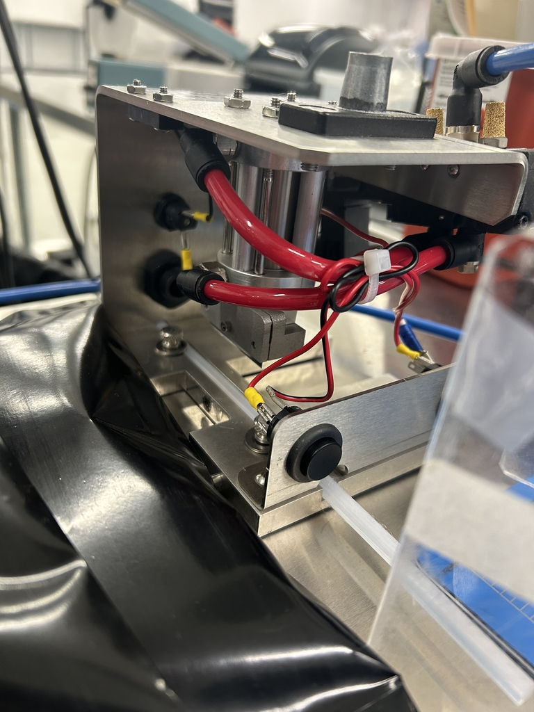
  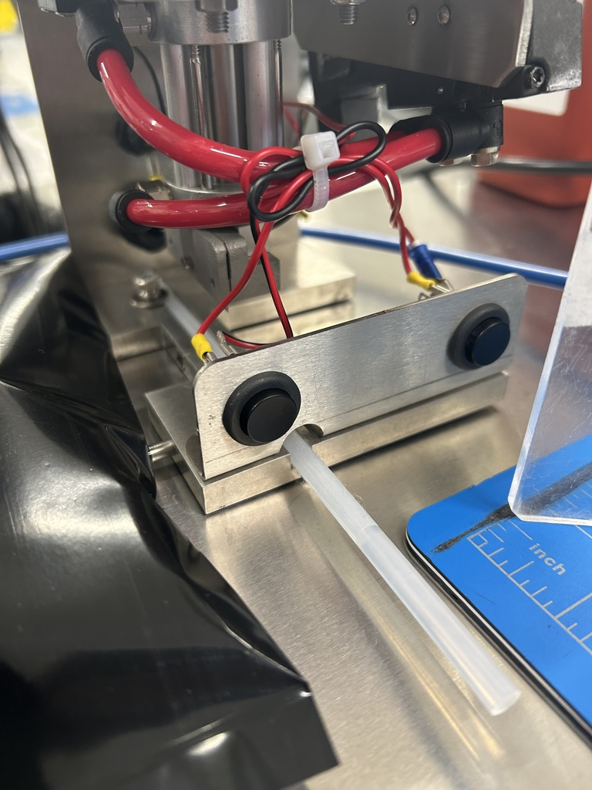

  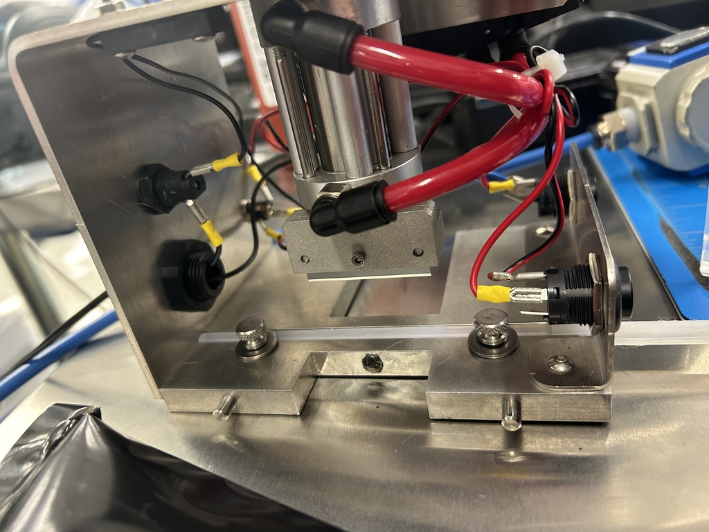

The existing cutter is pneumatic. A cylinder drives a razor blade straight down through the tube, and the operator fires it with the two push buttons. It has two problems:

1. **It crushes smaller tubes.** The chopping motion pushes the whole wall down at once, so thinner and softer tubes give way and deform before the blade gets through. The cut piece is used to measure the inner and outer diameters, so any deformation ruins the sample.
2. **The blade is exposed.** New safety standards no longer allow exposed blades, and the blade on this cutter is open at the front whenever it is not cutting.

### Where the Cut Piece Goes

  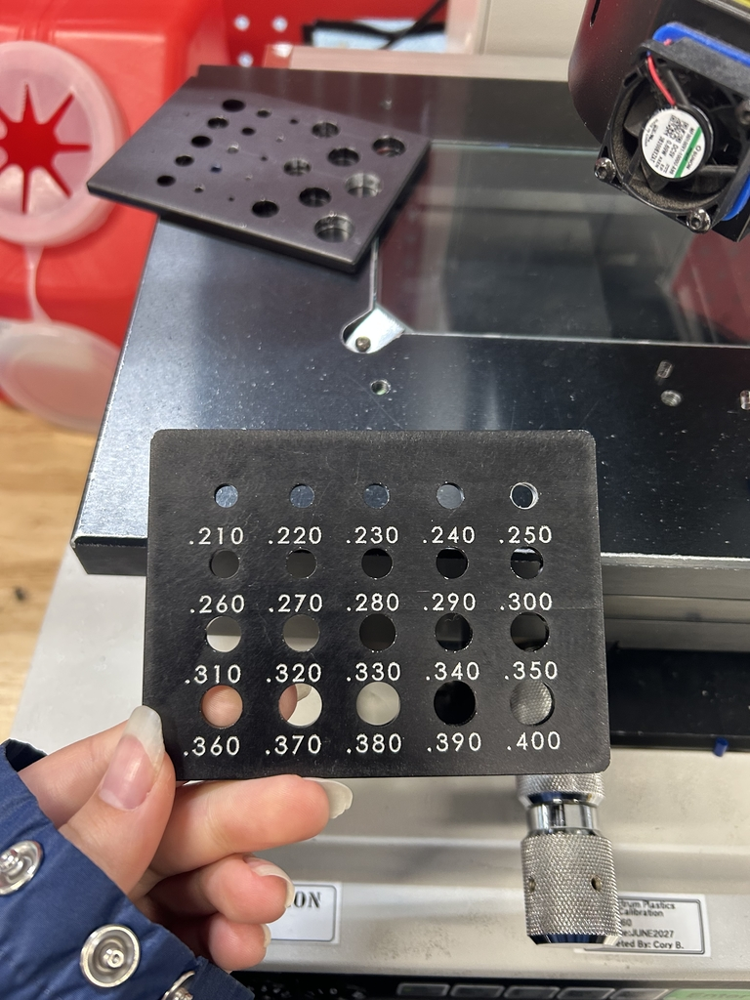
  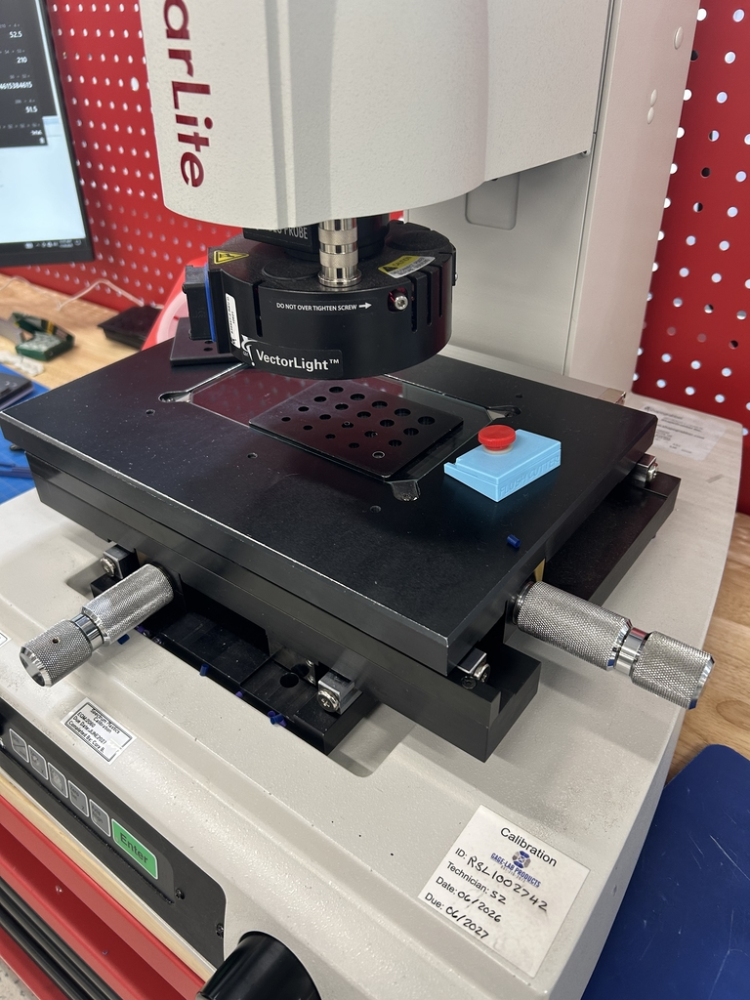

After cutting, the tube sample is carried over to the measuring microscope on a plate. The plate has a hole for each tube size from 0.210 to 0.400 in, in 0.010 in steps, which covers the full range the cutter has to handle. Because the measurement is taken on the cut face, the cut has to be square, clean, and free of crushing.

### How the New Design Solves Both

**Crushing:** Instead of chopping, the blade rotates around the fixed tube and feeds slowly deeper into the wall. Only a small section of the wall is being cut at any moment, so the tube is never squeezed flat. This gives a much higher quality cut, and it lets one machine handle every durometer and diameter in the range by changing the feed and speed instead of the blade.

**Exposed blade:** The blade lives inside the rotating barrel and is enclosed by the housing, so it is never reachable during operation. Removable front guard plates cover the blade and come off only for blade changes (see the sketch below).

### Requirements

| Requirement | Value |
|---|---|
| Tube outer diameter | 0.21 to 0.40 in |
| Tube durometer | 50A to 72D |
| Cut plane | Within a few thousandths of the outer face of the tool |
| Blade | Razor blade, enclosed, removable for replacement |
| Tube feed | From the side, since tube length varies |
| Controls | Rotation speed and feed rate set per tube type |

### Challenges

The blade has to cut right at the face of the plate that carries the cut piece over to the microscope, so the cutting plane needs to be within a few thousandths of the outermost part of the tool. The tube also has to be held so that friction from cutting softer tubes doesn't spin the tube along with the cutter, which would ruin the run. Vibration is another issue: small vibrations mean the blade position on one revolution won't match the next, leaving scoring on the face that is going to be measured.

Electronics will control the rotation and feed rate for each cut. The controller has to know the inner and outer diameter of the tube, the cutter's depth relative to the outer radius, the rpm, how many cuts the blade has made since it was last replaced, and the durometer for each operation. That is far more to tell a machine than it takes to cut a tube by hand, so the interface has to be intuitive and quick. One way to reduce the input is to measure the outer diameter with a sensor, so only the inner diameter has to be entered.

It would be easier to feed the tube from the top so gravity doesn't act on the rotating part of the cutter, but feeding from the side is more important because the length of tube available varies.

The whole system has to do a better job than a cutter that just moves straight down, while staying nearly as easy to use. This is a common problem across automation. Manual methods have been refined for hundreds of years to be cheap and efficient, and an automated version has to either match that with lower operating costs or give results good enough to justify the extra cost.

## Concept Development

  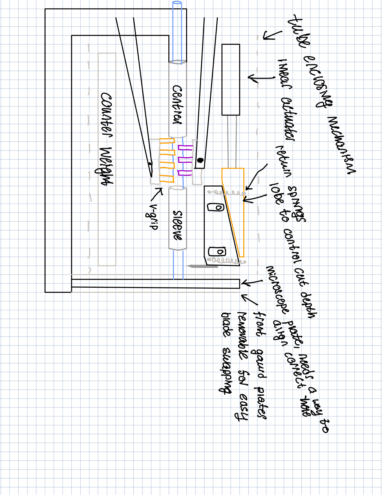

The concept sketch shows the full layout: the tube runs through a central sleeve with a V-grip to hold it, the blade holder is pushed in by a lobe driven by a linear actuator with return springs, a counterweight balances the rotating barrel, and the microscope plate sits at the front with removable guard plates over the blade.

Download: <a href="2156 sketches.pdf">Concept sketch (PDF)</a>

  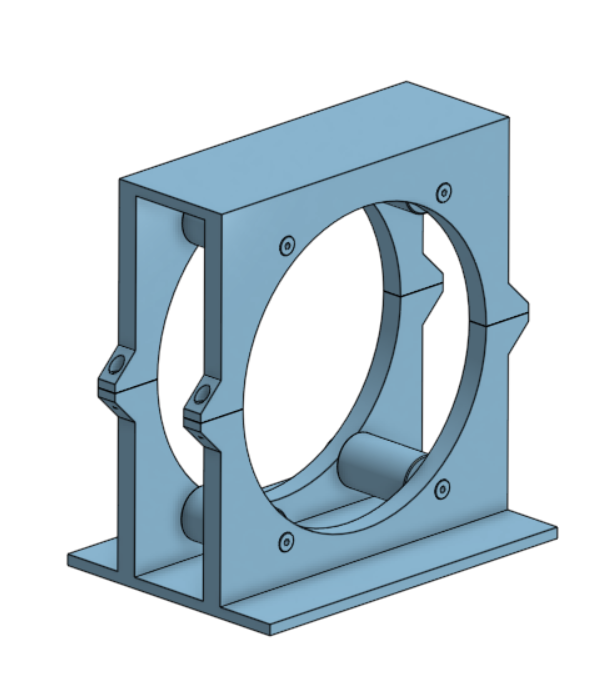
  
  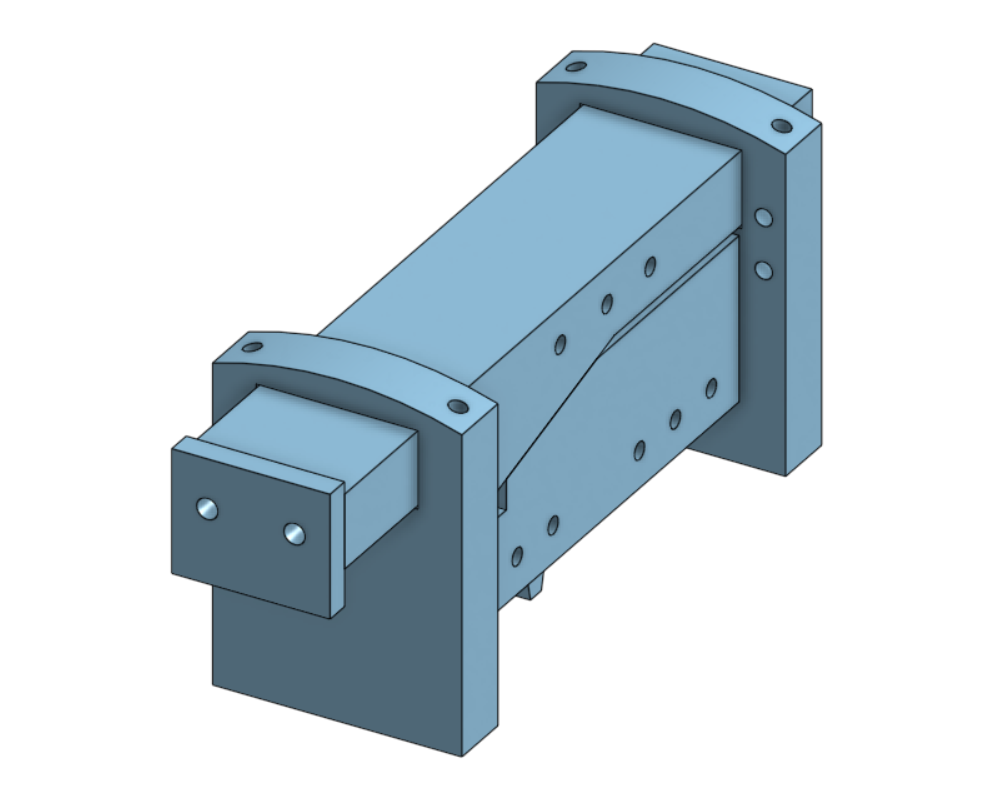

Download: <a href="Final Project Prototype Assem.stl">Final Project Prototype Assem.stl</a>

## Testing Critical Features

We decided to test the rotation and the cut depth motion with a prototype that has a version of the mechanism that will control each. The CAD for this was fairly straightforward. The barrel needed rollers to rotate on, and the original plan was two rollers on top and two on the bottom held between two enclosing prints. For the cut depth, a lobe is pushed inward to drive the blade holder toward the center of the barrel. Springs and M3 screws are used throughout to control the motion and hold the pieces together.

The lobe profile is the biggest open question. Too shallow an angle and it can bind, because friction is higher than the force pushing on it. Too steep and the ratio of linear travel to change in depth puts a lot of strain on the linear actuator and thrust bushing, and it limits how precisely the depth can be controlled. This prototype tests a 15° lobe, since that seems to be the recommended middle ground, and it can be adjusted based on test results.

The goal of this prototype is to find issues that haven't been addressed yet, and to show that the motion can be done rigidly and predictably without excessive binding. It is fully FDM printed, but part of the point is to identify which parts would be better suited to a different process. It also has to confirm which electronics package suits the design, so parts can be ordered in time to arrive for assembly before next Tuesday.

### Prints

Because of the number of parts, the prototype took 4 prints. The first two ran overnight on our personal printers, a Bambu Lab A1 and a P1S. The A1 print with the barrel and the bottom of the stand succeeded, but only the rollers finished on the P1S because of a clogged nozzle. Those parts were reprinted in the lab on printers 8 and 12, and they finished just in time for assembly and the in-class showcase. Since the top half of the stand failed, only the bottom half was shown in class, but the motion is the same either way.

  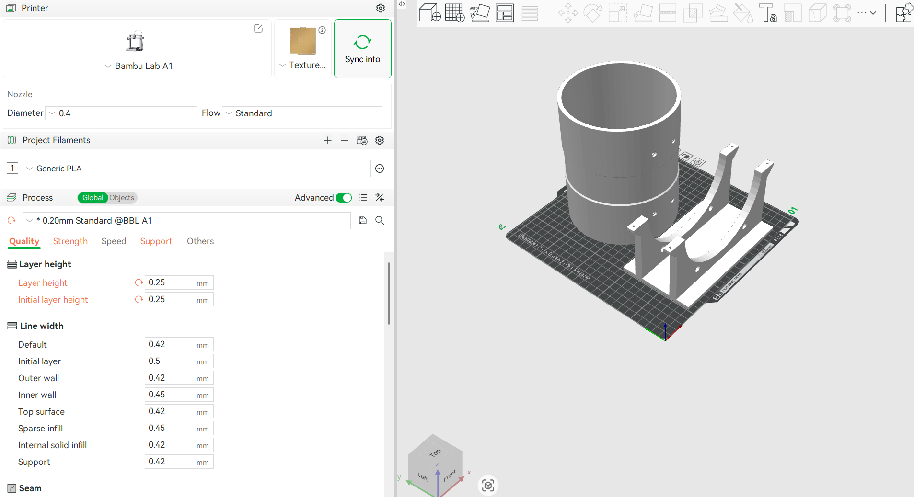
  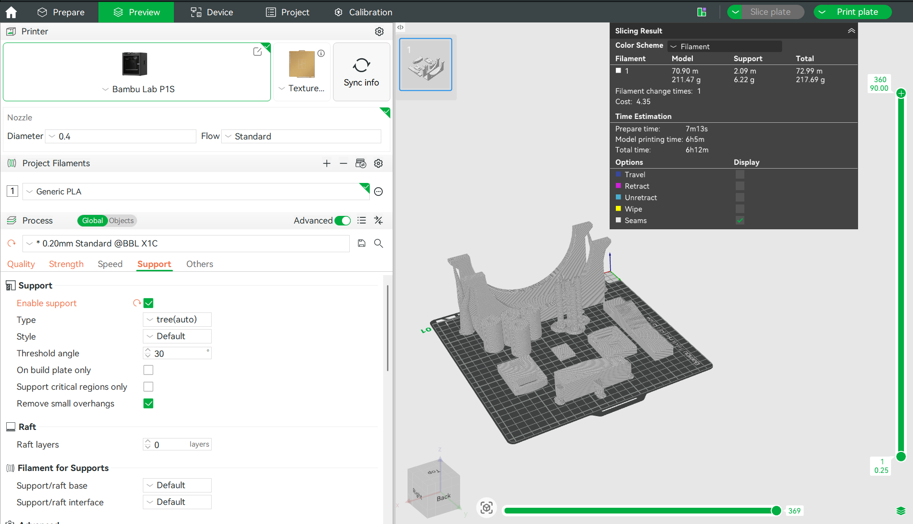

The P1S plate on the right is the print that failed.

  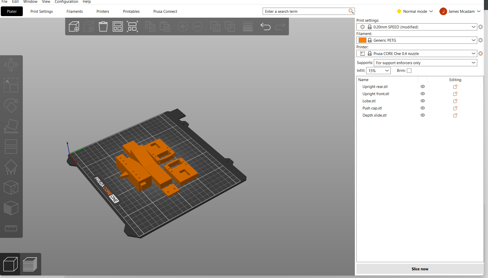
  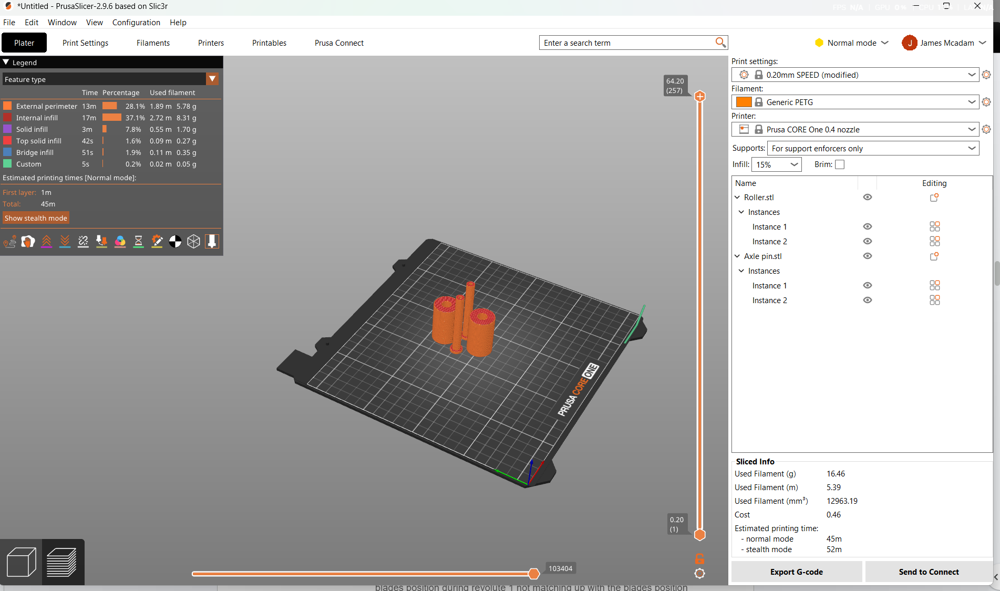
  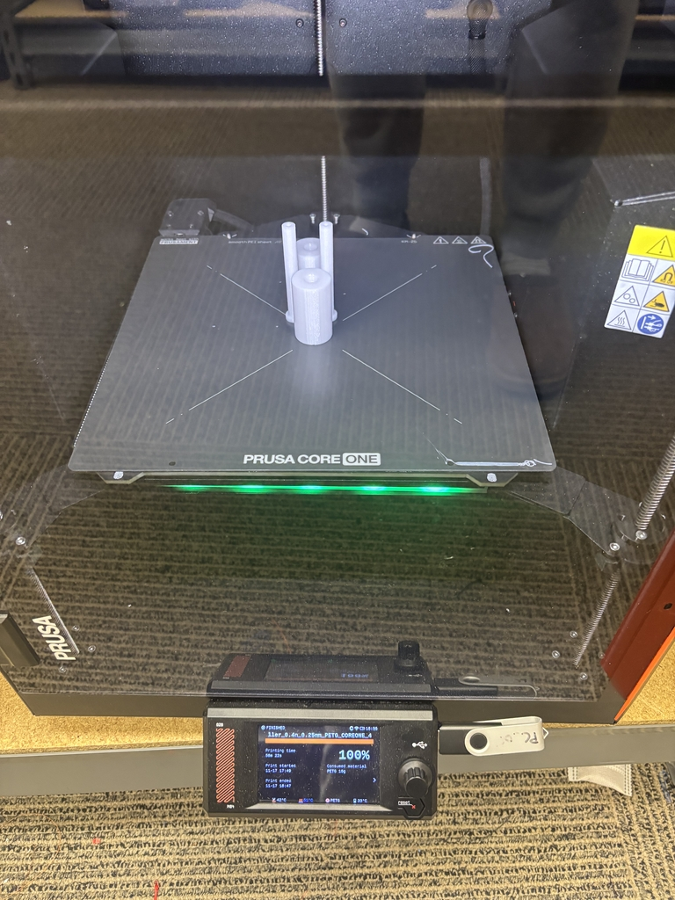

<video
  src="print_video.mp4"
  controls muted loop playsinline
  preload="metadata"
  style="display:block; max-width:100%; max-height:600px; margin:1em auto; border-radius:4px;">
  Your browser doesn't support HTML5 video.
</video>

| Print | Printer | Material | Parts | Time | Result |
|---|---|---|---|---|---|
| 1 | Bambu Lab A1 | PLA, 0.25 mm layers | Barrel, bottom of stand | Overnight | Succeeded |
| 2 | Bambu Lab P1S | PLA, 0.25 mm layers, tree supports | Remaining parts | 6 h 12 min (217.69 g) | Failed, clogged nozzle (only rollers finished) |
| 3 | Prusa Core One (lab) | PETG, 0.20 mm SPEED, 15% infill | Front and rear uprights, lobe, push cap, depth slide | | Succeeded |
| 4 | Prusa Core One (lab) | PETG, 0.20 mm SPEED, 15% infill | 2 rollers, 2 axle pins | 45 min (16.46 g) | Succeeded |

<!-- TODO: photos of the assembled prototype and results of the rotation and lobe tests. -->

## Video Presentation

<!-- TODO: 30-second video explaining the problem. -->

## Lessons Learned

Splitting the print across personal printers overnight saved lab time, but it also meant a failure wasn't caught until morning. The clogged nozzle on the P1S cost the top half of the stand and forced reprints in the lab right before the showcase.

<!-- TODO: in-class feedback and what changes for the next loop of the spiral. -->

**Time:** About 8 hours were spent on this assignment.
